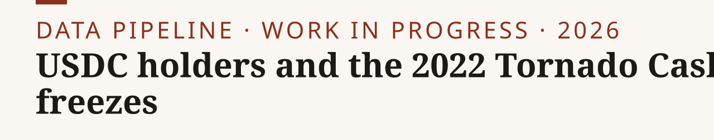

<p><picture><source media="(prefers-color-scheme: dark)" srcset="assets/banner-dark.svg"></picture></p>

**A data-construction pipeline for a study of how stablecoin holders responded to Circle's 2022 USDC freezes after the Tornado Cash sanctions. Every number is rebuilt from raw Ethereum mainnet JSON-RPC calls.**

[Data](#data-availability) · [Site](https://nikkhosravipour.com)

[](LICENSE) [](LICENSE-docs) [](https://www.python.org/) [](#status)

> [!NOTE]
> **Work in progress.** This repository holds the data construction only. No estimates or results are reported here, and the analysis is unfinished. The research was carried out during a research internship at the American Institute for Economic Research (Fall 2026). Views and code are the author's own.

## Quick start

1. Clone: `git clone https://github.com/nik110403/tornado-usdc.git && cd tornado-usdc`
2. Check provenance (chain id and pinned blocks): `python3 run_all.py --gate none`
3. Run one gate: `python3 run_all.py --gate g0`, or all of them in order: `python3 run_all.py --gate all` (stops at the first failure)
4. Check the result: each gate writes `out/<gate>/summary.md` with its acceptance checks.

Python 3.10+ is assumed. The pipeline uses the standard library only, with no web3 library and no environment variables. The endpoints are public and keyless. Gate runs against live public endpoints can take up to a couple of hours. To use a different endpoint (for example one with a key), edit `config/endpoints.json` and keep the key out of version control.

## How the pipeline stays auditable

- **Raw JSON-RPC.** `lib/rpc.py` posts `eth_getLogs`, `eth_call`, `eth_getCode` and related calls to the public endpoints listed in `config/endpoints.json`, respecting each endpoint's measured block-range and OR-array caps. No API keys are used.
- **Pinned blocks.** No query uses `latest`. Every query pins a numeric block from `config/blocks.json`, and the chain id (1) is asserted at the start of a run. Windows are anchored to timestamps, resolved to blocks once by bisection and then pinned.
- **Keccak self-test.** `lib/keccak.py` is a pure-Python keccak-256. At import it asserts known digests (the empty string and `Transfer(address,address,uint256)`) before any event topic is used. Topic hashes are computed, never copied from a document.
- **Per-fetch receipts.** Every range fetch appends a receipt (endpoint, block range, address count, topics, log count, sha256 of the payload) to `out/<gate>/receipts.jsonl`. At the end of a gate, `assert_tiling` checks that the receipts cover the declared block span with no gap and no overlap. A range that fails on both endpoints is a gap and fails the run.
- **Second-endpoint re-verification.** 5% of ranges (minimum 5) are re-fetched on a different endpoint and must match in log count and in a sha256 over the sorted log tuples.
- **Balances** are read with `eth_call balanceOf(address)` only, not from storage slots (USDC packs the blacklist flag into the balance slot).

## Gate map

Each stage in `gates/` exposes `run(cfg) -> int` (0 = pass) and writes a `summary.md` with its acceptance checks. Raw outputs (`out/*/*.csv`, `receipts.jsonl`) are regenerated by the gates and not committed. Only the summaries are.

| Gate | Stage | Script | Output |
|---|---|---|---|
| g0 | Tornado Cash pool manifest; Circle and Tether blacklist event censuses | `gates/g0_manifest.py` | `out/g0/summary.md` |
| g1 | Exposed cohort by arm and holding type; pre-period daily balances | `gates/g1_cohort.py` | `out/g1/summary.md` |
| g1b | Control sampling-frame probe | `gates/g1b_frame.py` | `out/g1b/summary.md` |
| g1c | Control-side balance probe | `gates/g1c_funnel.py` | `out/g1c/summary.md` |
| g2 | Reconstruction integrity (supply invariants, freeze intersection, reconciliation) | `gates/g2_integrity.py` | `out/g2/summary.md` |

### Gate funnel

Taken verbatim from `out/*/summary.md`; see those files for the acceptance checks.

- g0: 97 emitters in the census (91 Tornado Cash instances, 6 other); 174,184 deposit logs and 161,570 withdrawal logs; 23 designated pools holding 163,870 deposits; 38 distinct addresses in the Circle blacklisting cluster at blocks 15,302,549 to 15,302,766.
- g1: 60,707 unique withdrawal-arm recipients; 87,051 deduplicated cohort addresses, of which 331 are contracts and 86,720 are externally owned; 8,384 with at least one pre-period transfer; 7,080 in the daily panel; 4,508 pass the holding floor.
- g1b: control-frame exclusion set of 88,130 addresses; 172,296 surviving candidate addresses from 30 sampled block windows.
- g1c: 2,000 addresses sampled from the g1b survivors.
- g2: 6/6 USDC and 6/6 USDT supply-invariant windows match after the documented USDT correction; 30/30 stratified reconciliations match.

## Data availability

| Dataset | Source | Access | Included |
|---|---|---|---|
| Ethereum mainnet event logs and contract calls | Public JSON-RPC endpoints in `config/endpoints.json` | Public, keyless | No; regenerated by the gates |
| Pinned block numbers | Resolved from timestamps by bisection | Public | `config/blocks.json` |
| Gate summaries (counts and checks) | This pipeline | CC BY 4.0 | `out/*/summary.md` |

Contracts: USDC `0xA0b86991c6218b36c1d19D4a2e9Eb0cE3606eB48`, USDT `0xdAC17F958D2ee523a2206206994597C13D831ec7` (both 6 decimals). Pre-period: 2022-06-09 00:00 UTC to 2022-08-07 23:59 UTC. First Circle `Blacklisted` event: block 15,302,549 (2022-08-08).

No off-chain or personal data is used. Wallet addresses are pseudonymous on-chain identifiers; no attempt is made to link them to individuals.

## Tests

```bash
python3 -m pip install pytest
pytest -q
```

The tests cover the keccak implementation and the RPC client. They do not call the network.

## Repository layout

```text
tornado-usdc/
├── run_all.py         # runs one gate or all gates in order
├── lib/               # JSON-RPC client, pure-Python keccak, block pinning
├── gates/             # g0–g2 pipeline stages
├── config/            # endpoints and pinned blocks
├── out/               # per-gate summary.md (raw outputs not committed)
├── tests/             # keccak and RPC client tests (offline)
├── assets/            # banner and social preview (made by tools/banner)
└── CITATION.cff
```

## Status

The estimation code and results will follow in a versioned release with a DOI once the paper is final.

## Citation

GitHub shows a "Cite this repository" button from `CITATION.cff`. BibTeX:

<details>
<summary>BibTeX</summary>

```bibtex
@misc{tornado_usdc2026,
  author = {Khosravipour, Nik},
  title  = {USDC holders and the 2022 Tornado Cash freezes: data-construction pipeline},
  year   = {2026},
  url    = {https://github.com/nik110403/tornado-usdc}
}
```

</details>

## License

Code: [MIT](LICENSE). Text and gate summaries: [CC BY 4.0](LICENSE-docs).
