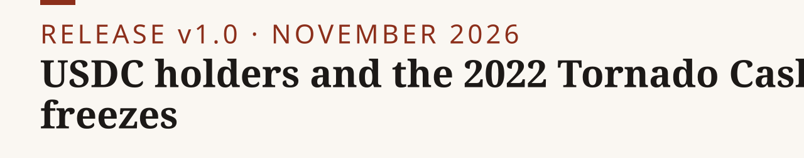

<p><picture><source media="(prefers-color-scheme: dark)" srcset="assets/banner-dark.svg"></picture></p>

**Code, signed pre-specification and aggregate results for a study of how stablecoin holders responded to Circle's 2022 USDC freezes after the Tornado Cash sanction. The data were built from raw Ethereum mainnet JSON-RPC calls, and the code to rebuild them is here.**

[Paper](#the-paper) · [Check it](#check-it-in-60-seconds) · [Provenance](PROVENANCE.md) · [Data](#data-availability) · [Site](https://nikkhosravipour.com)

[](.github/workflows/verify.yml) [](LICENSE) [](LICENSE-docs) [](https://www.python.org/) [](install_r_packages.R) [](#status)

The `verify` badge covers two things only: the hash check of the signed files (T0) and the Python tests. The R tests run locally, not in CI. See [What can be checked](#what-can-be-checked).

> The research was carried out during a research internship at the American Institute for Economic Research (Fall 2026). Views and code are the author's own.

## The paper

Nik Khosravipour, *Issuer Discretion and Stablecoin Holdings after the Tornado Cash Sanction*, 12 November 2026. A link follows here once the paper is posted.

On 8 August 2022 the US Treasury sanctioned Tornado Cash and listed 38 addresses. Circle froze USD Coin (USDC) at those addresses that day; Tether froze no Tether (USDT) at those addresses then. The paper compares the USDC and USDT holdings of 4,487 past Tornado Cash users, not themselves frozen, with 11,495 matched wallets that had no recorded Tornado Cash use before the event.

**The finding, with its limits.** Past users' USDC holdings minus USDT holdings, scaled by each wallet's usual combined holdings and with extreme values capped, fell by 0.152 relative to matched wallets (wallet-clustered 95% confidence interval: −0.184 to −0.120). The interval lies wholly below −0.10, so the rule fixed in advance says "supported". But the gap was already falling before the event; with later baselines ending 7 August (an exploratory check dated 28 October, `results/o3/`) the fall is 0.098 to 0.129, with intervals containing −0.10. Without the cap, the gap, combined-holdings and USDC estimates are positive and none is statistically significant at the 5 percent level, so these results do not show a switch from USDC to USDT. Nor can they separate reactions to the sanction from reactions to Circle's freeze, which happened on the same day.

The decision record is `results/post/post_decisions.csv`; the estimates are in `results/post/post_estimates.csv`.

## Check it in 60 seconds

```bash
git clone https://github.com/nik110403/tornado-usdc.git && cd tornado-usdc
python3 tools/verify_release.py
```

No data, no network, standard library only. It recomputes the four hashes in `prespec/SHA256` and the 35 entries of `prespec/code_manifest.txt` and prints what a pass shows and what it does not. The sha256 of `prespec/SHA256` is `6bc01a5c9132beceec8289e015ef3393ed83b581074259d6c1e44e8cc1a6516e`, the value recorded in `prespec/signing.json`.

A pass shows that the files here are byte for byte the files hashed in the signing record of 28 October 2026. It does not show when they were hashed, that the analysis is correct, or that the paper's numbers regenerate from these inputs. [PROVENANCE.md](PROVENANCE.md) explains the signing, the frozen files and what the release cannot reproduce.

"Signed" here means the author's dated signing record (`prespec/signing.json`) over that hash list. It is not a cryptographic signature and not an external timestamp, and the study was not publicly registered. The shipped `prespec/prespec.md` still opens with its drafting heading, "DRAFT (unsigned)", because editing it would break the hashes.

## What can be checked

| Tier | What | Who can run it | Status |
|---|---|---|---|
| T0 | hash check of the signed files | anyone; no data | runs in CI |
| T1 | unit and fixture tests; the paper's headline, robustness, later-baseline and H2 tables and its two event-study figures, rebuilt from the shipped aggregates in `results/` | anyone; Python 3 and R 4.3.3 with the pinned packages | Python tests run in CI; R tests run locally (164/164) |
| T2 | an unsigned rebuild of the data from public Ethereum endpoints | anyone with time (about a day) | not yet run; counts comparable, hashes not |

The signed post-event stage itself cannot be rerun outside the author's machine; [PROVENANCE.md](PROVENANCE.md) says why.

## Quick start

Install the pinned R packages first. Without them most R-backed Python tests fail, because they only check that `Rscript` exists.

```bash
Rscript install_r_packages.R --dry-run              # list the pinned versions
Rscript install_r_packages.R --lib ~/R/tornado-usdc # install them (R 4.3.3 expected)
export R_LIBS_USER=~/R/tornado-usdc

python3 tools/verify_release.py                     # T0
python3 -m pip install pytest && python3 -m pytest -q   # T1, Python
Rscript run_all.R --stage test                      # T1, R
Rscript paper/exhibits.R --out exhibits --in results    # tables and figures from the aggregates
```

The exploratory analyses (O2, O4) need two more packages, HonestDiD 0.2.7 and CVXR 1.0-15, in a separate library: `Rscript install_r_packages.R --exploratory --lib ~/R/tornado-usdc-exploratory`. Their tests skip without it.

To rebuild the data (T2), run the gates in order with `python3 run_all.py --gate <name>` (see the gate map). The endpoints in `config/endpoints.json` are public and keyless; every query pins a numeric block. A full rebuild takes about a day.

## How the pipeline stays auditable

- **Raw JSON-RPC.** `lib/rpc.py` posts `eth_getLogs`, `eth_call`, `eth_getCode` and related calls to the public endpoints in `config/endpoints.json`, respecting each endpoint's block-range and OR-array caps. No API keys, no web3 library.
- **Pinned blocks.** No query uses `latest`. Every query pins a block from `config/blocks.json`, and the chain id (1) is asserted at the start of a run.
- **Keccak self-test.** `lib/keccak.py` is a pure-Python keccak-256 that asserts known digests at import, before any event topic is used.
- **Per-fetch receipts.** Every range fetch writes a receipt (endpoint, block range, topics, log count, sha256 of the payload); each gate checks that the receipts tile its block span with no gap and no overlap.
- **Second-endpoint re-verification.** A sample of ranges is re-fetched on a different endpoint and must match in count and sha256.
- **Balances** are read with `eth_call balanceOf(address)` only, and the daily balances are checked against those reads with zero tolerance.
- **Fail-closed post stage.** The post-event stage verifies the signature and the signed input hashes before it opens any input file, and refuses anything unsigned.

**What the signing dry run does not cover.** `tools/s24_dryrun.R` runs the post stage's pre-window checks on the candidate inputs before signing, offline, without opening any post-event panel. It does not cover the stops that need post-event data or the g0 files: the post panel reader, the g0 provenance check, the rematch cut-point and hash downgrade, and malformed g0 receipts. Those stops run in the post stage itself (`R/post_gate.R`) and in the assembler; the `semantic_checks` docstring in `tools/s24_package.py` lists what is and is not checked.

## Gate map

Python gates in `gates/` build the data; R stages in `R/` (through `run_all.R`) estimate. Each gate writes a `summary.md` with its acceptance checks; raw and wallet-level outputs are regenerated and never committed.

| Stage | What | Script | Record shipped |
|---|---|---|---|
| g0 | Tornado Cash pool manifest; Circle and Tether freeze censuses | `gates/g0_manifest.py`, `g0_blacklist_ext.py`, `g0_baseline_blacklist.py` | `out/g0/`, `out/g0_ext/summary.md` |
| g1 | exposed cohort, baseline participation, holding floors | `gates/g1_cohort.py` | `out/recovery/g1/gen-M-20261024/` |
| g1b, g1c | control sampling frame and balance probe | `gates/g1b_frame.py`, `g1c_funnel.py` | `out/g1b/`, `out/g1c/summary.md` |
| g2 | reconstruction integrity (supply invariants, reconciliation) | `gates/g2_integrity.py` | `out/g2/summary.md` |
| g3 | pilot minimum detectable effect | `gates/g3_mde.py` | `out/g3/summary.md` |
| g4 | control baseline panel and matching covariates; June placebo population | `gates/g4_controls.py`, `g4_june.py` | `out/recovery/main/gen-M/summary.md` |
| pre, presign | matching (CEM), placebo, pre-signing checks | `R/pre.R`, `R/cem.R`, `R/presign.R` | `out/r_pre/summary.md`, `results/placebo/` |
| signing | assembles the package signed on 28 October 2026 | `tools/s24_package.py` | `prespec/` |
| g5, post | post-event panel; signed estimation and decision | `gates/g5_post.py`, `g5_veto.py`, `R/post.R`, `R/post_gate.R`, `R/decide.R` | `results/post/` |
| O1-O4 | exploratory analyses planned after signing | `exploratory/` | `results/o3/`, `exploratory/README.md` |

## From the 15 October snapshot to the paper

The first public version of this repository (15 October 2026) stopped at g2. The cohort rules were then corrected before signing: exposure and the contract screen end at the end of the pre-period (block 15,298,282, 7 August 2022) instead of the event block, and a baseline-participation rule was added. The counts changed accordingly:

| Step | 15 Oct snapshot | Paper | Record |
|---|--:|--:|---|
| Unique withdrawal-arm recipients | 60,707 | 60,591 | `out/recovery/g1/gen-M-20261024/summary.md` |
| Externally owned cohort addresses | 86,720 | 86,571 | same |
| With a baseline USDC or USDT Transfer | 8,384 | 8,370 | same |
| Pass the holding floors | 4,508 | 4,502 | same; `out/recovery/main/gen-M/summary.md` |
| Eligible (not blacklisted in the baseline) | — | 4,501 | `results/post/post_rematches.csv` |
| Exposed wallets with a matched control | — | 4,487 | `results/post/post_cluster_sizes.csv` |
| Matched control wallets | — | 11,495 | same |

The g1 record keeps one failed acceptance check as it was written: 60,591 unique recipients against a target of 60,629.

## Data availability

| Dataset | Source | Access | Included |
|---|---|---|---|
| Ethereum mainnet event logs and contract calls | public JSON-RPC endpoints in `config/endpoints.json` | public, keyless | no; regenerated by the gates |
| Pinned block numbers | resolved from timestamps by bisection | public | `config/blocks.json` |
| Gate records (counts and checks) | this pipeline | CC BY 4.0 | `out/**/summary.md` |
| Aggregate results | this pipeline | CC BY 4.0 | `results/` (sources and hashes in `results/README.md`) |
| Wallet-level lists and panels | this pipeline | not distributed | no; regenerated by the gates |

Contracts: USDC `0xA0b86991c6218b36c1d19D4a2e9Eb0cE3606eB48`, USDT `0xdAC17F958D2ee523a2206206994597C13D831ec7` (both 6 decimals). Pre-period: 9 June to 7 August 2022. First Circle `Blacklisted` event: block 15,302,549 (8 August 2022).

No off-chain or personal data is used. Wallet addresses are pseudonymous on-chain identifiers; no attempt is made to link them to individuals. No file here holds the address of a studied wallet; the only addresses in the tree are public contracts and synthetic test fixtures; the other long hex strings are event-topic hashes. The aggregates in `results/` are not covered by the signed hashes: they were produced after signing.

## Repository layout

```text
tornado-usdc/
├── run_all.py, run_all.R   # entry points: Python gates, R stages
├── config/                 # endpoints and pinned blocks
├── lib/                    # JSON-RPC client, pure-Python keccak, block pinning
├── gates/                  # g0–g5 data stages
├── R/                      # matching, estimation, signed post stage, decision rule
├── prespec/                # the signed pre-specification (frozen bytes)
├── addenda/                # dated, hashed addenda after signing
├── exploratory/            # O1–O4, planned after signing
├── diagnostics/            # reconciliation diagnostics
├── tools/                  # T0 verifier, signing assembler, helpers
├── paper/exhibits.R        # tables and figures from results/
├── results/                # aggregate outputs
├── out/                    # gate records (summary.md only)
├── tests/                  # Python and R tests, offline
├── docs/CROSSWALK.md       # internal labels in the frozen files
├── assets/                 # banner
├── install_r_packages.R    # pinned R packages
├── MANIFEST.sha256         # sha256 of every file in this release
├── CITATION.cff
└── PROVENANCE.md           # what was signed, how to check it, what it cannot show
```

## Status

**v1.0, November 2026.** This release ships the code behind the paper's numbers, the signed pre-specification byte for byte, its addenda and the aggregate results. The analysis was pre-specified, signed and hashed privately on 28 October 2026; at that point no 9 August to 12 September 2022 outcome panel had been built and no main post-event contrast had been estimated. What had been seen before signing is listed in §0 of the pre-specification and in [addenda/2026-10-28_post-signing-disclosure.md](addenda/2026-10-28_post-signing-disclosure.md). The development history stays private; [PROVENANCE.md](PROVENANCE.md) explains how the commit ids in the frozen files relate to it.

Internal labels in the frozen files (S10b, gen-M, `chg-` ids, "tribunal") are explained in [docs/CROSSWALK.md](docs/CROSSWALK.md), not edited, because editing would break the hashes.

## Citation

GitHub shows a "Cite this repository" button from `CITATION.cff`. BibTeX:

<details>
<summary>BibTeX</summary>

```bibtex
@software{tornado_usdc2026,
  author  = {Khosravipour, Nik},
  title   = {USDC holders and the 2022 Tornado Cash freezes: code, signed pre-specification and aggregate results},
  version = {1.0},
  year    = {2026},
  url     = {https://github.com/nik110403/tornado-usdc}
}
```

</details>

## License

Code: [MIT](LICENSE). Text, the pre-specification and addenda, gate records, hash lists and aggregate results: [CC BY 4.0](LICENSE-docs).
